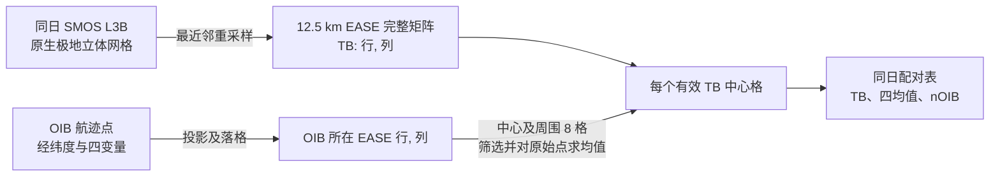

本目录已完成 2017 年论文第 5.1 节的 **OIB—SMOS 同日配准、3×3 空间取样、四变量算术均值**，以及可审计的 1.4 GHz 多层前向亮温、二分求解、理论解空间扫描和验证拟合。当前 `main.m` 的 `yearsToProcess=[2012,2015]`，用于论文原始验证年份；已有四年扩展配准和反演结果包含 16,364 条配对。2013/2014 是本项目增加的扩展验证。在 MATLAB R2023a 中进入本目录运行相应入口。需要 Mapping Toolbox。

本程序用于复现论文'Data Synergy between Altimetry and L-Band Passive Microwave Remote Sensing for the Retrieval of Sea Ice Parameters—A Theoretical Study of Methodology'整体框架，后续可能进行小尺度开阔水面、冰间水道考虑。

# 2017 论文数据配准（MATLAB）

## 论文所说的四个均值

2017 年论文 *Data Synergy between Altimetry and L-Band Passive Microwave Remote Sensing for the Retrieval of Sea Ice Parameters—A Theoretical Study of Methodology* 第 5.1 节说：对每次 OIB 飞行取 **同一天**的 SMOS TB；对每个 SMOS TB 中心格，把该格及周围八个 12.5 km EASE 格内的 OIB 测量作为样本，覆盖约 37.5 km × 37.5 km。排除混合冰型、开阔水和冰间水道后，对全部剩余 OIB **原始点**的以下四个量分别求算术均值：

| 论文记号 | 本地 OIB 字段或计算 | 单位 | 在论文验证中的作用 |
| --- | --- | --- | --- |
| `FBsnow` | `mean_fb`，雪面/总干舷 | m | 激光测高 + TB 路线的干舷输入 |
| `hs` | `snow_depth` | m | 雪深验证参考 |
| `FBice` | 逐点 `mean_fb - snow_depth`，冰面干舷代理 | m | 雷达测高 + TB 路线的干舷输入 |
| `hi` | `thickness` | m | 冰厚验证参考 |

若中心格 $j$ 的九格内有 $M_j$ 个通过筛选、四个量均有效的 OIB 点，则
$$
\overline q_j=\frac{1}{M_j}\sum_{p=1}^{M_j}q_p,
\qquad q\in\{FB_{snow},h_s,FB_{ice},h_i\}.
$$
同一批样本用于四个均值，因此 `mean(FBice) = mean(FBsnow) - mean(hs)`。这里按 **原始点数**加权；九个格子不会先各算一个均值再等权平均。邻近中心格的九格窗口会重叠，一个 OIB 点可能对应多个 SMOS TB，这正是按每个中心格取样的结果。

论文把 OIB 的 `FBice` 当作雷达干舷代理；它是雪面干舷减雪深得到的量，并非独立 CryoSat-2 观测。`hi` 和 `hs` 用于验证。`main_inversion.m` 已逐条计算两条路线的反演值，并保留雪面干舷路线的第二支解。

## 坐标与配准顺序



1. `read_smos.m` 读取 ICDC SMOS L3B **逐日** NetCDF。原文件是 896×608 的北极极地立体网格，带逐像元经纬度；`read_oib.m` 读取 2012–2015 年 OIB 航次，并将数值缺测 `-99999` 转为 `NaN`。2012/2013 使用正式 IDCSI4，2014/2015 使用 NSIDC-0708 Quick Look。
2. `ease_grid.m` 定义完整北极原版 EASE 目标矩阵：1441×1441，步长 12,533.76 m，左上外边界 `(-9030574.08, 9030574.08)` m。像元中心为 `x(c)=xMin+(c-0.5)Δ`、`y(r)=yMax-(r-0.5)Δ`。
3. `regrid_smos_to_ease.m` 从每个目标中心逆向寻找最近的原 SMOS 像元，复制其 TB；原像元无 TB 或 `nPair<=0` 时保留缺测。只对 TB 做一次网格转换，**不对九个 SMOS TB 求均值**。
4. `PSP2EASE.m` 把每条 OIB 记录的经纬度投影到目标平面，按 `col=floor((x-xMin)/Δ)+1`、`row=floor((yMax-y)/Δ)+1` 定位行列；这是位置落格，不对 OIB 数值插值。
5. `collocate_2017_day.m` 先保留四变量均有效、`pcnt_ow=pcnt_thin_ice=pcnt_grey_ice=0`、`my_ice_flag` 为 FYI/MYI 的记录；再以每个 SMOS 中心格的 3×3 窗口汇总四个原始点总和与共同样本数。九格内同时含 FYI 与 MYI 的中心格被排除。第 5.1 节未要求负 `FBice` 阈值，因此此处不另加阈值。
6. `main.m` 按 `yearsToProcess` 处理对应年份，每次只取同日 SMOS。当前设置为 2012/2015：23 次飞行、6,542 条配对。四年扩展实验曾处理 48 次飞行，其中 46 日产生有效配对：2012/2013/2014/2015 年分别为 3,690/4,389/5,433/2,852 条。2012-03-28 对应九格区域内无有效 SMOS TB；2013-03-20 在当前质量和冰型筛选后没有有效 OIB 点。详情看 `summary`。**不会**把 3–4 月亮温先求季节均值。

### PSP 与 EASE 是否有旋转

在当前代码采用的投影定义下，SMOS 源 PSP（EPSG:3413）的中央经线为 **−45°**，目标北极 EASE 的经度原点为 **0°**，所以同一经纬度在两套平面坐标中的极地方位相差 **45°**。但两者分别是极地立体投影和兰伯特方位等积投影，离极点的平面距离也不同，而且比例随纬度变化：例如 (80°N, 0°E) 在 PSP 中约为 (768, −768) km，在 EASE 中约为 (0, −1111) km。因此**不能把整张像素矩阵只旋转 45°**；代码通过目标格中心的经纬度在两个投影之间逐点转换，再取源 TB。

## 反演入口

四年共有 16,364 条有效配对。论文的后续反演单位是**每一条配对**：先分别用 (TB, FBice) 和 (TB, FBsnow) 两条路线求解，再汇总多天的结果；不能先把多天 TB 或 OIB 值合成一个均值。

`main_inversion.m` 现只读取 2012/2015 年缓存，默认 `runSolver=false`，只加载 6,542 条输入；显式启用求解后，运行时约每 1% 输出日期、完成比例、耗时/预计剩余时间、有解数和双解数，新结果使用 `inversion_2012_2015_current_model` 前缀。`model` 含论文第 2.1 节的冬季温度、海水温盐和密度常数。`invert_2017_pair.m` 已实现论文图 5/6 的两条求解路线：雷达干舷以 4 cm 步长找区间再二分，雪面干舷以 1 cm 步长扫描所有变号区间再二分，并保留双解。论文没有规定亮温残差阈值，代码暂用 0.01 K。雪面干舷双解在第 5.2 节验证中默认取雪深较小的一支。

`solution_space_2017.m` 按第 2.2 节扫描 0–10 m 冰厚、0–1 m 雪深，依据静力平衡计算两种干舷并排除负冰面干舷；默认扫描间隔为 5 cm / 1 cm，**这是代码设置而非论文指定数值**。`plot/plot_solution_space_2017.m` 可绘制对应图 3/4 的 TB—干舷解空间。`fit_retrieval_2017.m` 计算图 11/12 使用的自由斜率最小二乘拟合、固定斜率为 1 的偏差和 RMSE。启用求解后，主程序也会按论文用模拟 OIB TB 与 SMOS TB 相差不超过 1.5 K 的样本另算一组验证统计。

`tb_forward.m` 已补全式 (1) 的数值链：冰雪稳态温度廓线、FYI/MYI 盐度、Cox–Weeks 卤水体积分数、Vant 海冰介电常数、Tiuri 干雪介电常数、Klein–Swift 海水介电常数、层间 Fresnel 系数及 Burke 一阶非相干辐射递推。默认采用 **20 层冰、1 层雪**，输出 0–40°、H/V 极化算术平均，并加入可关闭的 2.7 K 宇宙背景反射；未把论文验证所得的 1.6–1.8 K 偏差硬编码成大气修正。

2017 联合反演论文正文只明确说采用改进的 `multi-layer formulation`，没有直接写“20 层”。同年文献 [32] 的层数敏感性试验写明使用 `N=20`；周璐博士论文进一步明确为 **海冰 20 层、雪 1 层**。因此，本项目把 20/1 作为目标复现配置，把 `model.nIceLayers=1` 仅作为单层敏感性基线，不能把单层结果当作 2017 联合反演的最终前向模型。

`validate_tb_forward.m` 对照论文表 1 的 8 个理想场景，并比较 1/20/100 层。本实现的表 1 RMSE 为约 2.09 K、平均偏差为约 −1.81 K；5 m 厚冰场景的 20→100 层差异小于 0.1 K，但薄冰场景仍有更强层数敏感性。这个结果与论文报告的约 1.6–1.8 K 模拟偏差量级接近，但尚不是作者代码级完全闭合。当前 `main_inversion.m` 默认不运行全量求解。实际四年结果及与论文的差异见 `RESULTS_2012_2015.md`。

`model.radiativeTransferMode="upperReflection"` 可传播上层向下发射、经下方物理界面反射后返回的亮温。该模式把层数敏感性测试中 20→100 层最大差从约 5.08 K 降至 0.15 K，但表 1 RMSE 从约 2.11 K 增至 5.78 K，FYI–MYI 代表场景差值也从约 11.44 K 降至 1.16 K，因此目前仅作为层数收敛性敏感性方案；默认 `"burke"` 继续用于论文复现和反演。

`validate_inversion_closure_2017.m` 独立执行 8 场景、两条路线的自闭环和论文表 1→表 2 闭环；可写出逐组摘要与逐支解 CSV。自闭环全部恢复真值，雪面自由板路线的 II、VI 各有两支解；论文输入下当前前向模型未复现表 2。具体数值、无解原因和运行命令见 `CLOSURE_2017.md`。该入口不触发全量反演或参数/层数敏感性分析。

温盐及界面审查、两种界面 Fresnel 口径的八场景闭环结果与后续交接见 `analysis/温盐廓线与物理界面审查及后续交接.md`。默认前向模型仍使用层中点介电常数；`model.interfacePermittivityMode="boundary"` 可检查物理界面两侧介电常数方案。逐层源项仍由层中点温度计算。

### 亮温前向模型的文献链

文献 [32] 的式 (5) 是海冰、水道、开阔水的**面积混合**，式 (6) 是把 3×3 EASE 区域内各 OIB 点的**已模拟海冰亮温**取均值。2017 联合反演只保留无水道、无开阔水的单一冰型样本，因而式 (5) 的面积权重可简化为 `αice=1`、其余为 0；但式 (6) 里的单点 `TBice(hi,hs,Tsfc,iceType,...)` 仍须计算。这里的 `TBice` 指整套雪—冰—海水层状系统在海冰覆盖区的辐射亮温，不是仅由海冰温度乘一个常数得到。

计算链为：候选冰厚、雪深和冰型 → 雪/冰各层温度与盐度 → 各层复介电常数 → 层间 Fresnel 反射、吸收和自发辐射 → 0–40°、两种极化的平均模拟 TB。2017 联合反演论文第 2.1 节把整条链压写成式 (1)。关键上游资料为：

1. [Maaß 等（2013）第 2.1 节](https://tc.copernicus.org/articles/7/1971/2013/)：明确采用 Burke 等（1979）的分层辐射传输模型，系统包含空气、雪、海冰与海水，说明温度剖面和材料介电常数的来源。
2. [Kaleschke 等（2010）第 2.2 节](https://tc.copernicus.org/articles/4/583/2010/)：给出冰的介电常数随盐水体积分数变化的公式，以及 1.4 GHz 的冰型系数表；其原始例子主要是**无雪单冰层**，不能直接代替当前多层雪冰模型。
3. [Zhou 等（2018）附录 A](https://tc.copernicus.org/articles/12/993/2018/)：同一作者对所用模型补充了 FYI/MYI 盐度剖面、热导率、雪和冰介电常数、盐水体积分数及顶层亮温式；其余光学/辐射传输细节继续引用前述模型及更早实验关系。

`TBice` 的逐层辐射计算已经实现，并以论文表 1、FYI/MYI 约 12 K 冰型差异以及厚冰层数收敛作回归检查。公开的 Burke 模型及 NCAR 的 Klein–Swift 海水介电实现只作为公式补全依据；当前代码明确标为可审计重建，不能称为 Zhou 等（2017）的原作者代码。

**比较亮温所在层级：**SMOS 的 L1C 是大气层顶亮温，ICDC L3B 对 L1C 的水平/垂直极化与 0–40°入射角做日平均；[Kaleschke 等（2012）](https://doi.org/10.1029/2012GL050916)和[ICDC L3B 说明](https://www.cen.uni-hamburg.de/en/icdc/data/cryosphere/docs-cryo/documentation-smos-tbs.pdf)分别说明了这两步。Zhou 等（2018）附录 A1 写出 `TB_TOA`；在纯冰覆盖 `c=1` 时为 `TBice + (1-eice)*2.7 K + ΔTB_atm`。这里 `TBice` 是**海冰覆盖区的雪—冰—海水系统辐射分量**，不是冰表温度；海水仍是冰下的辐射边界。2017 年文献 [32] 的式 (5) 省写背景/大气项，并报告与 SMOS 比较的亮温偏差约 1.6 K。原论文固定的是水温、水盐度等输入参数，并未把 `TBice` 或 `TBwater` 固定为常数；附录 A1 也没有给出可直接计算逐日 `ΔTB_atm` 的完整方法。实现时必须明确采用哪一版亮温校正约定，不能把该偏差擅自解释成纯大气贡献。

亮温为本人推导逐层递推公式，参考文献为上文。
2026.10.22引入 https://github.com/Peteysoft/sea_ice 参考，引入上下行辐射耦合，代码中可自行选择亮温前向模型计算方式。

### 密集度、密度与 OIB 字段

论文 [32] 的混合像元式 (5) 使用海冰、再冻结水道和开阔水的面积比例；这些比例来自独立海冰密集度产品和 MODIS 水道图，不是由 OIB 的雪深、干舷计算。2017 年联合反演论文第 2.1 节限制为无开阔水、无水道、单一冰型的冬季海冰；第 5.1 节排除混合区域。因此当前反演只需要 OIB 的冰型标记，以及 `FBice` / `FBsnow` 作为输入，`hi` / `hs` 用于验证。水、冰、雪密度固定为 1024/915/320 kg/m³，表温 −30°C、水温 −1.8°C、海水盐度 33 g/kg。

本地 OIB 表包含 `pcnt_ow`、`pcnt_thin_ice`、`pcnt_grey_ice`、`my_ice_flag`；当前配准用前三项及冰型标记筛除明显混合区域。它们不是论文 [32] 式 (5) 的独立海冰密集度与 MODIS 水道比例，不能把当前筛选视为完整水道掩膜。

若改做文献 [32] 的辐射模型验证，式 (6) 还会逐 OIB 点使用表面温度；本地原始表已有 `KT19_surf`，`read_oib.m` 读表时会保留它，但当前四变量均值配准不会聚合它。2017 联合反演论文的典型冬季实验直接采用固定 −30°C。

## 运行与输出

缓存名现在由年份列表逐项组成：`pairs_2012_2015_same_day.mat` 只含论文年份，`pairs_2012_2013_2014_2015_same_day.mat` 含四年扩展数据。`main` 发现同名缓存中的飞行年份与配置不符时会自动重建。2012/2015 缓存已从原始 OIB/SMOS 数据重建为 23 次飞行、6,542 条配对；原有四年缓存按准确年份重命名保留。原始观测数据不随仓库提交。

```matlab
cd('D:\海冰厚度联合反演\retrieval_matlab_ver')
main
head(pairs)
summary
main_inversion  % 当前只加载 2012/2015 两年输入，默认不运行求解器
```

- `processed/pairs_2012_2015_same_day.csv/.mat`：仅 2012/2015 的 6,542 条配对。
- `processed/pairs_2012_2013_2014_2015_same_day.csv/.mat`：四年扩展实验的 16,364 条配对。
- `processed/inversion_2012_2015.csv/.mat`：历史四年逐配对反演值、双解、TB 模拟值、掩膜和理论解空间；文件名早于当前年份命名规范。
- `processed/inversion_2012_2015_metrics.csv`：四年合并指标。
- `processed/inversion_2012_2015_metrics_by_year.csv`：逐年指标。
- `processed/inversion_2012_2015_paper_years_metrics.csv`：只含论文验证年份 2012/2015 的可比口径。
- `processed/tb_forward_table1_validation.csv`：论文表 1 的 8 个场景、当前模拟 TB、差值和卤水适用范围诊断。
- `processed/tb_forward_layer_sensitivity.csv`：FYI/MYI 代表场景下 1/20/100 层亮温对比。
- `figures/pairs_2012_2015_coverage.png`：2012/2015 配准位置及九格内 OIB 样本数。
- `figures/pairs_2012_2013_2014_2015_coverage.png`：四年扩展实验配准位置。
- `analysis/tb_difference_vs_hi_hs_8_scenarios.png/.svg`：表 1 八场景的冰厚/雪深与 `TBmodel−TBpaper` 图，见 `analysis/README.md`。
- `figures/retrieval_validation_all_revised.png`：全部有效解的论文图 11 风格验证图。
- `figures/retrieval_validation_tb_within_1p5K_revised.png`：1.5 K 子集的论文图 12 风格验证图。
- `figures/tb_model_vs_smos_revised.png`：观测与模拟亮温对比，纵轴为模型亮温。

配准质检由 `plot/plot_2017_pairs.m` 绘制；反演散点与亮温比较由 `plot/plot_retrieval_validation.m` 绘制。实际指标与复现边界见 `RESULTS_2012_2015.md`。

需要重算所选年份时在 `main.m` 将 `useCache = false`，运行后可改回 `true`。若要重建四年扩展缓存，先把 `yearsToProcess` 设为 `2012:2015`；若要执行两年全量反演，须显式设 `runSolver=true` 后运行 `main_inversion`。本次审查没有运行全量反演。图像只绘制数千个有效配对点，避免为全部原始航迹反复生成大图。

## 复现边界

2017 年论文第 5.1 节称其 SMOS TB 为 **Level-4、12.5 km EASE 网格**，文献 [46] 指向 ICDC 的 *SMOS Daily Polar Gridded Brightness Temperatures*。本地文件也来自 ICDC 这一数据系列，但下载文件标为 **L3B v3、12.5 km 极地立体网格**。因此不是已证实换用了另一种 SMOS 观测产品；区别是论文所述的处理级别/最终网格与当前本地文件的发布标注/原始网格。当前代码把本地文件自己转换到 EASE，正是为了完成这一空间配准步骤。论文没有给出可唯一确认的 EASE 版本、重采样算法或其所用具体文件版本；本项目明确采用原版北极 EASE、EPSG:3413 源几何检查和最近邻 TB 重采样，**不能保证数值与作者完全一致**。原版 EASE 参数见 [NSIDC 指南](https://nsidc.org/data/user-resources/help-center/guide-ease-grids)，本地 SMOS 文件说明见 [ICDC L3B 数据页](https://www.cen.uni-hamburg.de/en/icdc/data/cryosphere/l3b-smos-tb.html)。

论文图 7、8 是理论解空间的输入误差敏感性图，并非这份 OIB—SMOS 配准表的可视化，当前阶段不绘制。用户提供的文献 [32] `Improving L-band radiation model and representation of small-scale variability to simulate brightness temperature of sea ice.pdf` 保留供后续讨论前向模型使用。
